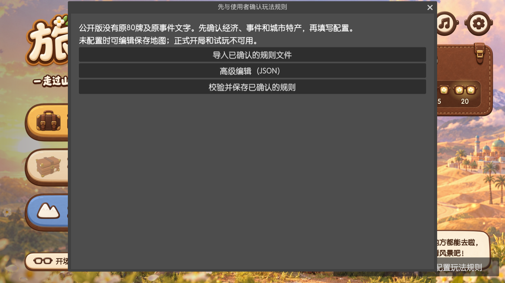

# 旅行L叔 · 游戏与地图工坊

带着骆驼和小船穿过立体城市、体验商旅与旅行，也能亲手制作地图的个人非官方原型。

**产品定版名称：旅行L叔 v0.1。** 已接受的r2装配基线及其公开清理交付保持；本仓库程序和安装包沿用技术版本 `0.2.4-public.1`。[版本、源码与各平台SHA256映射](VERSIONING.md)。r4仍是待GUI复测候选，不作为本次默认交付。

> **先看公开版状态：** 原桌游80张贸易牌数值、事件原文、商品供应量和城市起始物资均为空。下载后可进入四幕旅行、编辑和保存地图；**正式商旅对局与工坊试玩需要先配置自有规则**，并验证配置与本版引擎兼容。没有随包提供原桌游完整玩法或另设默认经济。

## 下载游戏与工坊

**当前公开版本：[v0.2.4-public.1 · Release与全部附件](https://github.com/chengzeyuan94-hub/L_travel/releases/tag/v0.2.4-public.1)**（预发布原型，安装包已上传）。

| 你的设备 | 下载入口 | 包内内容 / 大小 |
|---|---|---|
| Mac · Apple Silicon / Intel | **[⬇ 下载 macOS Universal DMG](https://github.com/chengzeyuan94-hub/L_travel/releases/download/v0.2.4-public.1/LTravel-0.2.4-public.1-macOS-universal.dmg)** | 游戏 + 地图工坊 · 约1.36 GiB |
| Windows · x86_64 | **[⬇ 下载 Windows 完整 ZIP](https://github.com/chengzeyuan94-hub/L_travel/releases/download/v0.2.4-public.1/LTravel-0.2.4-public.1-Windows-x86_64.zip)** | 游戏与工坊的EXE、PCK · 约1.31 GiB |
| Android · arm64，Android 7.0+ | **[⬇ 下载游戏 APK](https://github.com/chengzeyuan94-hub/L_travel/releases/download/v0.2.4-public.1/LTravel-0.2.4-public.1-Android-arm64-v8a.apk)** | 游戏 · 约901 MiB |
| Android · arm64，Android 7.0+ | **[⬇ 下载地图工坊 APK](https://github.com/chengzeyuan94-hub/L_travel/releases/download/v0.2.4-public.1/LTravel-Workshop-0.2.4-public.1-Android-arm64-v8a.apk)** | 工坊 · 约901 MiB |

[安装方法](INSTALL.md) · [SHA256校验表](https://github.com/chengzeyuan94-hub/L_travel/releases/download/v0.2.4-public.1/SHA256SUMS) · [版本与包清单](https://github.com/chengzeyuan94-hub/L_travel/releases/download/v0.2.4-public.1/release-manifest.json)

Mac：打开DMG，把两款.app拖到Applications。Windows：解压整个ZIP，EXE与同名PCK放在一起。Android：按需要安装两款独立APK。`Source code (zip/tar.gz)`是源码，请从上表选择安装包。

这是预发布版本，`/releases/latest`稳定版接口不会返回它；找不到安装包时请打开上面的**指定版本页面**。文件较大，下载速度取决于网络。

*公开版macOS安装包实际运行画面。四幕旅行与普通骆驼、小船无需额外胜场解锁。*

## 第一次打开，先做什么？

想看风景：选择「旅人模式」，进入长安、盘橐、巴格达或「L叔去哪儿」。想做地图：选择「打开地图工坊」，先放城、再连路线，随时保存草稿。

想开始商旅：点界面右下角 **「配置玩法规则」→「导入已确认的规则文件」**。先与使用者确认货物供应、起始物资、贸易牌组、陆海事件及生成参数，使用自己的文字和数值；也可以通过高级JSON入口编辑。保存后重新打开工坊，让地图重新校验。不会自动恢复原作牌组。

*未配置时会明确提示，正式开局与试玩被阻止，地图编辑和保存仍可使用。配置格式见[自有规则说明](RULES_CONFIGURATION.md)。*

## 商旅怎么玩？五步看懂

以下说明**已确认配置后的现有程序流程**，价格、供应和事件效果由自有配置提供。

1. **设置商人。** 设置2–4位真人或电脑商人。程序分配起始城市、交通工具和配置中的起始物资。
2. **掷骰，选路。** 当前掷骰实现有1–5的数值面和事件面。数值面可走0到该数字的步数：骆驼走陆路，商船走海路；只能在海陆交叉点、移动前或移动结束后换乘，不能中途换乘再接着走剩余步数。
3. **遇到事件，先处理。** 事件面按当前交通工具抽陆地或海洋事件；按自有事件效果处理物资、选择或事件移动，再继续回合。公开包没有默认事件牌。
4. **到城里，整组交易。** 选择当前城市贸易卡的付出项和收取项，按完整比例的整数倍交易，可一组或多组；不能拆成半组。库存、公共供应和货仓空间都要够。**每回合最多一次交易**，也可按配置的直接出售价卖货或跳过；普通道路不能交易，比例交易后更换当前贸易卡。
5. **结束回合，看谁赚得多。** 公共银库首次拿空，或设置的对局时长用完，就触发终局。先补齐本轮，让大家完成相同回合数，再比较：**白银多者胜 → 白银相同时比持有货物件数 → 仍相同则共同获胜。**

**当前配置限制：** 程序仍会掷出事件面，关闭事件的配置不会把它移除。验证完整商旅流程需要兼容的自有陆海事件；导入成功不代表整局流程或经济平衡已验证。详见[配置边界](RULES_CONFIGURATION.md#当前掷骰与事件边界)。

## 地图工坊能做什么？

新建地图、放置城市，连接陆路与海路，编辑停靠点；调整地形和植物，绑定自有模型、图片与城市卡资源；保存后可重开继续编辑。配置玩法并通过校验后，才可进入商旅试玩，返回继续修改。

*工坊可用的景德镇原创模型预览（CC0）。这是一张模型预览，不是商旅对局截图；完整素材与来源见[景德镇素材包](art-src/expansion-packs/jingdezhen-qinghuaci-v01/README.md)。*

## 安装与版本限制

macOS包为Universal、ad-hoc签名，**未Apple公证**；Apple Silicon上实际启动与界面已验证，Intel未实测。Windows与Android包已做导出、结构及签名等检查，**没有Windows/Android实机验收**；Android工坊触控与试玩返回仍需设备复核。不要把导出成功当作三端实机全部通过。

公开版清理了来源不明的独立音乐/环境音文件，普通音效使用静音占位；**四段旅行片头OGV仍含非静音音轨，正常播放可能出声，不能称整包无声。** 片头混音的独立来源/许可证据仍待补齐，既有一般制作署名不足以确认音轨权利。外部动作换成自主简化动作。完整历史验证见[Release验证说明](https://github.com/chengzeyuan94-hub/L_travel/releases/download/v0.2.4-public.1/VALIDATION.md)，新增已知问题见[定版状态](VERSIONING.md#已知问题与验收边界)。

定版审查已复现：第四幕默认旅行存档目录仍与旧版共用；变更或删除自有规则配置后，旧商旅存档可能恢复为当前规则或无效内容；部分合法草稿模型应用被整图严格校验阻止。本次文档对齐没有改变既有安装包，也不将29项局部回归通过概括为全部无缺陷。

Android两款应用的数据各自隔离；卸载通常清除应用私有数据，升级或卸载前先导出地图。同应用更新需保持同一签名。[数据与更新说明](INSTALL.md#安装与数据)

## 创作起点与致谢

下面保留最初三个月、V0.1原型分享时的创作介绍；“V0.1”描述当时阶段，本次安装包版本是0.2.4-public.1。

这是鳐鳐鱼的[《千年丝路》](https://yaofishgames.com/product/silk-road/)，也是我给孩子买的一款桌游。它把城市旅行、商品交易和路线选择结合起来，这套玩法给了我很大启发。于是我就想，能不能在这个基础上，做一次数字化的尝试？让程序帮忙提示流程、计算交易，再把地图上的城市变成立体建筑，让骆驼和小船真的动起来。今天给大家看的，是这个想法做了三个月之后的 V0.1 原型。商旅玩法的基础来自原作，我主要在画面、交互和自定义功能上做了一些尝试。

本项目未获得或暗示鳐鳐鱼、原作作者或任何角色品牌的官方授权、合作或认可。致谢不替代素材和文本许可，清理不等于法律免责。

## 给开发者与素材作者

[构建说明](BUILD.md) · [规则接口](RULES_CONFIGURATION.md) · [清理范围](CLEANUP.md) · [贡献约定](AGENTS.md)

使用Godot **4.7.1 stable**；完整源码包含`generated/traveler`。安装包对应冻结源码[tag v0.2.4-public.1](https://github.com/chengzeyuan94-hub/L_travel/tree/v0.2.4-public.1)，commit `09af7f35bdd892a186304a208e42f1217c367aed`；本次图文正文更新不改变这批包。

自有代码[MIT](LICENSE)；按[逐文件资产清单](ASSET_LICENSES.csv)指定的原创/AI辅助素材[CC BY 4.0](LICENSE_ASSETS.md)，景德镇既有CC0保留；Godot、其组件及其他来源保持[第三方条款](THIRD_PARTY_NOTICES.md)。原卡、原文、私人未清权IP、签名私钥与私人存档不在公开交付中。导入他人模型、图片或文字前，请先确认许可。

最后，再认真感谢一下鳐鳐鱼的[《千年丝路》](https://yaofishgames.com/product/silk-road/)。这套商旅玩法，是我整个项目的起点，也给了我很多关于亲子地理游戏的启发。如果你对这套玩法感兴趣，也可以了解一下原版桌游，体验一家人围坐在桌边玩的乐趣。
